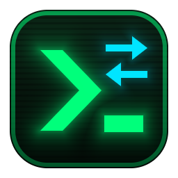

<p align="center"></p>

# claude-switch-windows

Windows 上给 Claude 桌面端用的一键切换账号工具，带一个终端风格的图形界面：

- **单击切换账号**：几个 Claude 账号来回切换，不用每次都去浏览器重新登录。单击账号卡片就换，十几秒后桌面端以那个账号重新打开。
- **看每个账号的剩余额度**：卡片上显示每个账号剩余的 5 小时额度和周额度，以及估算的恢复时间。
- **同步会话列表**：切换时自动把各账号的会话列表互相补齐，桌面端 Code 标签页里能看到所有账号的会话。
- 账号可以改名；添加账号、撤销上一次切换也都在界面里。

> 这是个人做的非官方工具，与 Anthropic 无关。它改动的是 Claude 桌面端的内部文件，这些文件格式没有公开说明，桌面端更新后可能失效。请先读完下面的「注意事项」再用。

## 原理

桌面端的数据文件夹：新版在 `%LOCALAPPDATA%\Claude-Data\claude_<编号>`，老版本在 `%APPDATA%\Claude`，工具会自动找。下面用 `<数据文件夹>` 指代。

**会话列表为什么换了账号就看不到？** 桌面端把 Code 标签页的会话列表按账号分开存放：

```
<数据文件夹>\claude-code-sessions\<账号编号>\<组织编号>\local_<会话编号>.json
```

对话内容本身存在 `%USERPROFILE%\.claude\projects\`，几个账号本来就是共用的。所以只要把各账号文件夹里的 `local_*.json` 互相补齐，切换账号后就能看到全部会话。规则：

- 某个账号没有的会话，从其他账号复制过去；
- 两边都有的，保留「最后活动时间」更新的那份；
- 在任何一个账号里删除过的不复制；
- 对话内容已经不在电脑上的不复制（打开也是空的）。

**怎么免登录切换账号？** 桌面端同一时间只能登录一个账号。一个账号的「登录状态」包括：

- `<数据文件夹>\config.json` 里的 `oauth:*` 和 `lastKnownAccountUuid`（加密的登录令牌）；
- `Network\Cookies`、`Local Storage`、`Session Storage`、`IndexedDB`（桌面端内置浏览器记住的身份）。

工具把每个账号的这些文件各存一份。切换时，先关闭桌面端，把当前账号的最新状态存回去（登录令牌会定期更新，旧的可能作废），再换上目标账号的，同步会话列表，最后重新打开桌面端。

**额度从哪来？** 桌面端运行时会隔一段时间把当前账号的用量百分比记进 `<数据文件夹>\plan-usage-history.json`。这个文件不随账号切换，所有账号的记录都在里面。工具只读这个文件，不联网，也不碰登录令牌。所以：

- 没在登录的账号，显示的是它最后一次登录时的数据；
- 超过 5 小时 / 7 天没有新记录的，额度一定已经恢复，显示「已恢复」；
- 记录里没有恢复时间，界面上的倒计时是按记录估的「最晚」恢复时间；记录太少时显示 `--`。

## 需要准备

- Windows 10 / 11，装好 Claude 桌面端；
- [Python](https://www.python.org/downloads/) 3.9 或更新版本（只用标准库，不用另外装包）。

## 安装

1. 把这个仓库下载到一个**固定的文件夹**（以后不要移动它），比如 `C:\Tools\claude-switch-windows`。
2. 在普通 PowerShell 窗口里运行下面这段，在桌面上创建「切换 Claude 账号」图标（用 `pythonw.exe` 打开，不弹黑窗口）。把第一行改成你放工具的文件夹：

```powershell
$dir = "C:\Tools\claude-switch-windows"
# 找真正装好的 Python（直接用 python 可能找到微软商店的空壳）
$exe = & py -c "import sys; print(sys.executable)" 2>$null
if (-not $exe) { $exe = & python -c "import sys; print(sys.executable)" }
$shell = New-Object -ComObject WScript.Shell
$s = $shell.CreateShortcut((Join-Path ([Environment]::GetFolderPath('Desktop')) '切换 Claude 账号.lnk'))
$s.TargetPath = Join-Path (Split-Path $exe) 'pythonw.exe'
$s.Arguments = '"' + (Join-Path $dir 'claude_switch_gui.py') + '"'
$s.WorkingDirectory = $dir
$s.IconLocation = Join-Path $dir 'assets\claude_switch.ico'
$s.Save()
```

## 使用

### 第一次设置（只做一次）

1. 双击「切换 Claude 账号」，点 `[ + 添加账号 ]`。
2. 先给**当前登录的账号**起个名字，再给**要添加的账号**起个名字。工具会关闭桌面端、保存当前账号，再把桌面端打开到登录界面。
3. 在桌面端里登录另一个账号（最多等 10 分钟；不想加了就点 `[ ✕ 取消等待登录 ]`，会恢复原来的账号）。
4. 登录成功后，工具会等大约 1 分钟让桌面端存好登录信息（这段时间先别开始新任务），然后自动关闭、保存、重新打开。

有更多账号就重复上面的步骤。

### 以后切换

单击要切换到的账号卡片，不用再确认。十几秒后桌面端会以那个账号重新打开，会话列表也已经同步好了。

- 卡片右上角的 `✎ 改名` 给账号改名字；
- `[ ↺ 撤销上次 ]` 撤销上一次切换或添加，回到之前的登录状态；
- `[ ⇄ 同步会话 ]` 单独同步会话列表（切换时会自动同步，一般用不到）；
- 操作进行中关不了窗口，免得登录状态只换了一半。

### 命令行用法

```text
pythonw claude_switch_gui.py         打开图形界面

python claude_switch.py              打开命令行菜单
python claude_switch.py list         列出已保存的账号
python claude_switch.py save 名字    把当前登录的账号存下来
python claude_switch.py switch 名字  切换到已保存的账号
python claude_switch.py add 名字     添加新账号（会打开登录界面）
python claude_switch.py undo         撤销上一次切换或添加
python claude_switch.py rename 旧名 新名  给已保存的账号改名

python sync_sessions.py              预览会同步哪些会话，不改任何文件
python sync_sessions.py --apply      正式同步（要先退出桌面端）
python sync_sessions.py --one-click  关闭桌面端 → 同步 → 重新打开
```

## 注意事项

- **不要在桌面端里点「退出登录」。** 这可能让保存好的登录失效，换账号统一用这个工具。
- **如果切换后停在登录界面**，说明那个账号保存的登录过期了。点 `[ + 添加账号 ]`，用那个账号重新登录一次即可；工具会认出它，只更新登录信息。
- **每次切换都会关闭桌面端**，里面正在进行的对话会被中断。
- 在一个账号里删除的会话，另一个账号里要再删一次。
- 定时任务（Routines）和 Cowork 会话不同步。旧会话里用到的 claude.ai 连接器换账号后可能要重新授权。
- 桌面端更新后如果文件格式变了，工具可能失效。切换前的状态都有备份，可以点 `[ ↺ 撤销上次 ]` 撤销。

## 项目文件

| 文件 | 作用 |
|---|---|
| `claude_switch_gui.py` | 图形界面，桌面图标打开的就是它 |
| `claude_switch.py` | 保存、切换、添加、撤销、改名的具体做法；也能单独当命令行工具用 |
| `sync_sessions.py` | 同步会话列表 |
| `plan_usage.py` | 从桌面端的用量记录里推算各账号的额度 |
| `assets/` | 图标；改了 `make_icon.py` 后运行它重新生成 `claude_switch.ico` |

## 文件存放位置

| 内容 | 位置 |
|---|---|
| 保存的账号（含加密的登录令牌） | `%LOCALAPPDATA%\claude-switch\profiles` |
| 每次切换前的登录状态备份（保留最近 10 份） | `%LOCALAPPDATA%\claude-switch\backups` |
| 会话列表同步前的备份 | 工具文件夹里的 `backups` |

登录令牌是用这台电脑、这个 Windows 用户专属的密钥加密的，拷到别的电脑或别的用户下用不了。即便如此，也不要把 `%LOCALAPPDATA%\claude-switch` 发给别人。

## 致谢

做法参照了下面两个 macOS 上的开源项目（均为 MIT 许可），并按 Windows 上的文件位置做了调整：

- [ai-usagebar](https://github.com/akitaonrails/ai-usagebar)
- [claude-acc](https://github.com/ohmaseclaro/claude-acc)

## 许可

[MIT](LICENSE)
